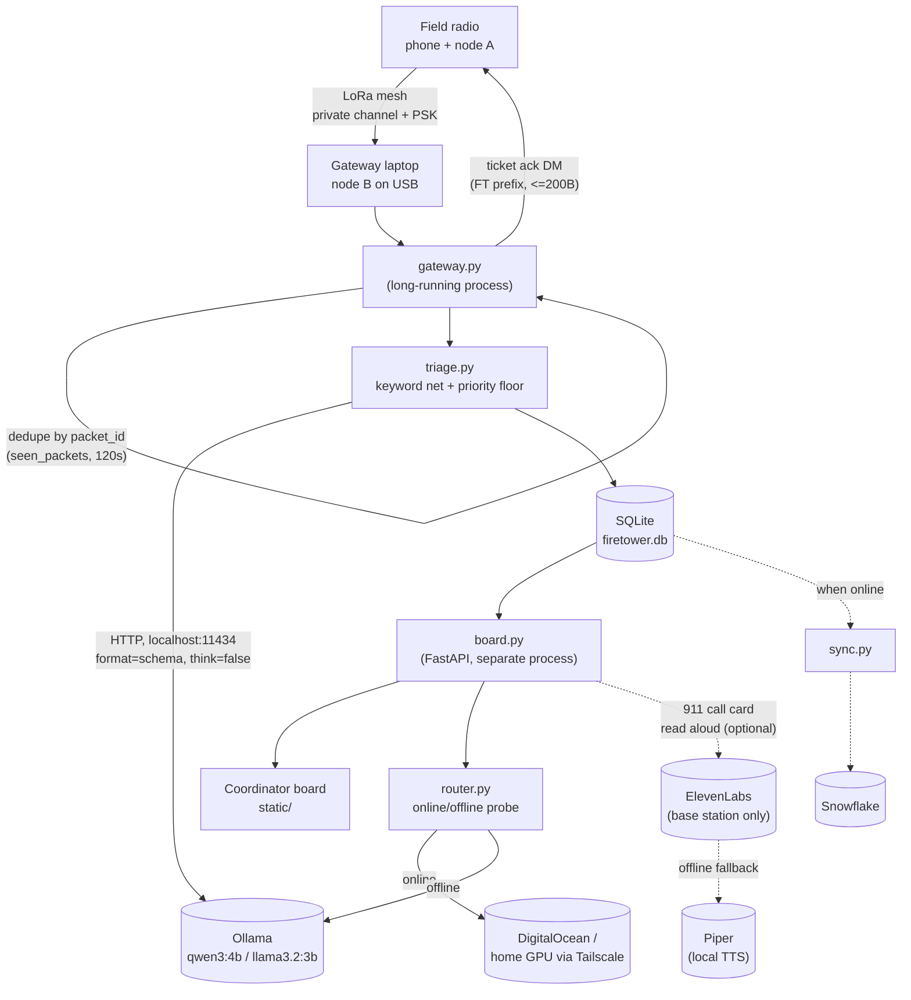

# Firetower

Off-grid triage for Meshtastic LoRa mesh messages. People in the field text short
messages over the mesh (no cell/internet required). A gateway laptop receives
every message, triages urgency with a local model, stores it, and shows a
coordinator board sorted by urgency. Triage always runs locally, so it keeps
working with the internet unplugged.

## Architecture

```
Field radio (phone + node A)
   │  LoRa mesh, private channel + PSK
   ▼
Gateway laptop (node B on USB)             gateway.py
   │  dedupe by packet id, hop count stored
   ▼
Triage: keyword net + local model          triage.py   (always local)
   │  priority-node floor applied
   ├──► SQLite firetower.db                db.py
   │       ├──► Coordinator board          board.py + static/ (FastAPI)
   │       └──► Snowflake, when online      sync.py
   └──► Ticket ack DM to sender            gateway.py

router.py: online/offline check; SITREP summaries go to the cloud model
           when online, the laptop model when offline.
```



ElevenLabs/Piper is optional and one-directional: the board calls it to read the
911 script aloud at the base station. It is never wired into the mesh, never
triggers a call by itself, and is not required for the core triage loop to work.

## Triage extraction schema

`triage.extract_with_model()` passes this JSON schema to Ollama's `format`
parameter so `qwen3:4b` returns structured output instead of prose. Only
fields the model itself should produce are here — `raised_by_keyword` is
computed afterward by `keyword_floor()`, and the priority-node floor is
applied afterward by `apply_priority_floor()`, so neither is asked of the
model:

```json
{
  "type": "object",
  "properties": {
    "urgency": {
      "type": "string",
      "enum": ["EMERGENCY", "PRIORITY", "WELFARE", "ROUTINE"]
    },
    "location": {
      "type": ["string", "null"]
    },
    "what_happened": {
      "type": ["string", "null"]
    },
    "injured_count": {
      "type": ["integer", "null"]
    }
  },
  "required": ["urgency", "location", "what_happened", "injured_count"]
}
```

Called with `options={"temperature": 0}` and `think=False` (or `/no_think` in
the prompt). `triage()` merges this output with the keyword floor and
priority-node floor into the final `TriageResult`.

## Model tiers

| Job | Internet up | Internet down |
|---|---|---|
| Triage + extraction | `qwen3:4b` on the laptop (Ollama) | same |
| SITREP summaries | DigitalOcean serverless open-weight model, home GPU over Tailscale as backup | `qwen3:4b` on the laptop |
| Reports | synced to Snowflake | saved locally, queued |
| Read-aloud voice | ElevenLabs | Piper |

- Backup local model: `llama3.2:3b`.
- Turn qwen3 "thinking" off (`"think": false`, or `/no_think` in the prompt). Temperature 0 for triage.
- The home-GPU tier still needs internet (Tailscale) — it only protects against a provider outage, not a real offline scenario.

## SQLite schema (`db.py`)

```sql
CREATE TABLE tickets (
    id INTEGER PRIMARY KEY AUTOINCREMENT,
    ticket_code TEXT UNIQUE NOT NULL,       -- e.g. FT-0001
    node_id TEXT NOT NULL,
    packet_id TEXT NOT NULL,
    received_at TEXT NOT NULL,              -- ISO 8601 UTC
    raw_text TEXT NOT NULL,
    urgency TEXT NOT NULL,                  -- EMERGENCY | PRIORITY | WELFARE | ROUTINE
    location TEXT,
    what_happened TEXT,
    injured_count INTEGER,
    raised_by_keyword INTEGER NOT NULL DEFAULT 0,
    priority_floor_applied INTEGER NOT NULL DEFAULT 0,
    hop_count INTEGER,
    latitude REAL,                       -- recent position packet snapshot
    longitude REAL,
    position_received_at TEXT,
    position_packet_json TEXT,
    meshtastic_packet_json TEXT,         -- received text packet snapshot
    status TEXT NOT NULL DEFAULT 'open',    -- open | assigned | closed
    assigned_at TEXT,
    synced_to_snowflake INTEGER NOT NULL DEFAULT 0
);

CREATE TABLE priority_nodes (
    node_id TEXT PRIMARY KEY,
    role TEXT NOT NULL                      -- e.g. "shelter lead", "registered medical need"
);

CREATE TABLE seen_packets (
    packet_id TEXT PRIMARY KEY,
    first_seen_at TEXT NOT NULL             -- dedupe window: 120s
);

CREATE TABLE node_positions (
    node_id TEXT PRIMARY KEY,
    latitude REAL NOT NULL,
    longitude REAL NOT NULL,
    received_at TEXT NOT NULL,
    meshtastic_packet_json TEXT NOT NULL
);

CREATE TABLE ai_threads (
    thread_id INTEGER PRIMARY KEY AUTOINCREMENT,
    node_id TEXT UNIQUE NOT NULL,           -- one running !ai thread per sender
    created_at TEXT NOT NULL
);

CREATE TABLE ai_messages (
    id INTEGER PRIMARY KEY AUTOINCREMENT,
    thread_id INTEGER NOT NULL REFERENCES ai_threads(thread_id),
    role TEXT NOT NULL,                     -- user | assistant
    content TEXT NOT NULL,
    created_at TEXT NOT NULL
);
```

Open in WAL mode (`PRAGMA journal_mode=WAL;`) since `board.py` polls while
`gateway.py` writes.

## Urgency precedence

`EMERGENCY > PRIORITY > WELFARE > ROUTINE`. A message from a node listed in
`priority_nodes` is never ranked below `PRIORITY`; `EMERGENCY` stays
`EMERGENCY`. The keyword safety net can only raise urgency, never lower it —
if it fires, the ticket is tagged `raised_by_keyword` and shown on the board.

## Radio rules (`gateway.py`)

- Payload limit is **bytes**, not characters: ≤ 200 bytes per chunk, UTF-8, no emoji; max 3 chunks ~3s apart.
- Reply by DM only; never broadcast; never process our own node's messages or anything starting `FT `.
- Dedupe by packet id for ≥ 120s (`seen_packets`).
- Text and GPS positions arrive as separate Meshtastic packets. Subscribe to
  `meshtastic.receive.text` and `meshtastic.receive.position`, join by `fromId`,
  and attach only a recent known position. Preserve packet dictionaries as JSON
  after removing protobuf `raw` objects and encoding byte payloads. Leave
  tickets without coordinates unpinned on maps.
- Use our own channel + PSK, never the default public channel. Gateway node name should contain "bot".
- A message starting `!ai <question>` (case-insensitive) is routed to `ai_assistant.answer()` instead of triage — it never becomes a ticket. The reply goes out via `gateway.send_ai_reply()`, DM only, `AI ` prefix, chunked and capped at `AI_MAX_CHUNKS` (3) so one answer can't flood the mesh with airtime. Each sender gets one persistent `ai_threads` row (`db.get_or_create_ai_thread`), so follow-up `!ai` messages continue the same conversation; the model's context is the thread history plus every ticket triaged on the channel so far (`ai_assistant.build_channel_context()`, capped to `CONTEXT_TICKET_LIMIT`).
- `qwen3:4b`'s `think=False` only reliably suppresses its reasoning trace on `format`-constrained calls (like `triage.py`'s extraction). Unconstrained chat calls (like `ai_assistant.py`'s) can still leak a `...</think>` block into `message.content` — strip everything up to and including the last `</think>` before using the reply.

## Hard rules

- **Firetower never dials 911 itself.** The 911 card only prepares a script for a human to read and logs "I called 911" — it never places a call, in testing or in the demo.
- Voice output (ElevenLabs/Piper) is base-station only, never sent over the mesh.
- Don't claim this is the first AI-on-Meshtastic project, "disaster-proof", or a replacement for 911/medical advice. "Works offline" applies only to triage and the local model, not Snowflake sync, SITREP-via-cloud, or map tiles.

## Dev setup

```
python -m venv .venv
source .venv/bin/activate   # or .venv\Scripts\activate on Windows
pip install -r requirements.txt
cp .env.example .env         # fill in local values
ollama pull qwen3:4b
ollama pull llama3.2:3b
```

Run the board: `uvicorn board:app --reload`. Run the gateway: `python gateway.py`.

## Conventions

- No CDN links in `static/` — vendor JS/CSS into `static/vendor/` so the board works offline.
- Triage must degrade gracefully: if the JSON-schema extraction from Ollama fails, fall back to keyword-only classification rather than dropping the message.
- `router.py` is the only place that decides online vs. offline; other modules ask it, they don't probe the network themselves.
- `FIRETOWER_MOCK=1` makes `board.py` serve `fixtures/mock_tickets.json` from memory instead of the real DB — lets the board/frontend be built and demoed against the real API shape before `db.py`/`triage.py` are implemented. Keep `fixtures/mock_tickets.json` in sync with the ticket schema above if you add a column.
- Modules only do `logger = logging.getLogger(__name__)` and log their own decisions (model fallback, keyword net firing, priority floor applied, online/offline transitions). Only process entrypoints (`gateway.py` `main()`, `board.py` `startup()`) call `logging_config.setup_logging()`, so handlers are configured exactly once. Logs go to stdout and `data/firetower.log` (`LOG_PATH`/`LOG_LEVEL` env vars), which is gitignored.
- Run tests with `pytest` from the repo root (`pip install -r requirements.txt` first). `tests/test_triage.py` and `tests/test_router.py` mock Ollama/`requests`/`db`, so they run with no live model or database.
