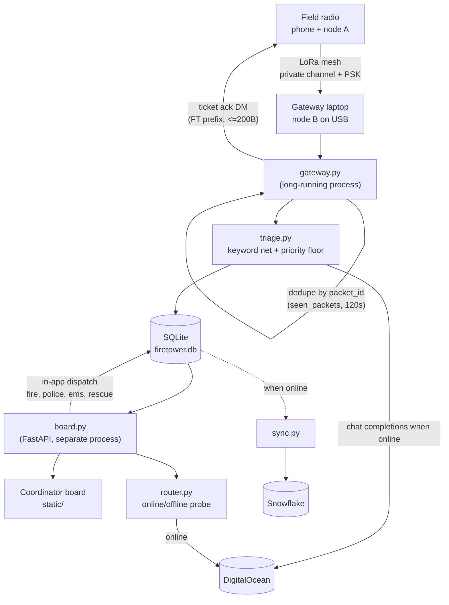

# Firetower

Off-grid triage for Meshtastic LoRa mesh messages. People in the field text short
messages over the mesh (no cell/internet required). A gateway laptop receives
every message, triages urgency, stores it, and shows a coordinator board
sorted by urgency. Model extraction uses DigitalOcean when that client is
configured and the link is up. With the internet unplugged, urgency falls
back to the keyword net. No local Ollama model is called.

## Architecture

```
Field radio (phone + node A)
   │  LoRa mesh, private channel + PSK
   ▼
Gateway laptop (node B on USB)             gateway.py
   │  dedupe by packet id, hop count stored
   ▼
Triage: keyword net + DigitalOcean        triage.py
   │  priority-node floor applied; keyword-only if the cloud call cannot run
   ├──► SQLite firetower.db                db.py
   │       ├──► Coordinator board          board.py + static/ (FastAPI)
   │       └──► Snowflake, when online      sync.py
   └──► Ticket ack DM to sender            gateway.py

router.py: online/offline check. SITREP model selection returns the
           DigitalOcean model when online and no model when offline.
```



Open emergency reports show the teams `dispatch.py` chose from the report
(fire, police, EMS, rescue). Dispatch writes those teams onto the ticket and
marks it assigned. It stays on the coordinator board: no 911 call, no contact
with a department, and no voice read-aloud.

## Triage extraction schema

`triage.extract_with_model()` asks DigitalOcean for this JSON object
(temperature 0). Only fields the model itself should produce are here —
`raised_by_keyword` is computed afterward by `keyword_floor()`, and the
priority-node floor is applied afterward by `apply_priority_floor()`, so
neither is asked of the model:

```json
{
  "type": "object",
  "properties": {
    "urgency": {
      "type": "string",
      "enum": ["EMERGENCY", "PRIORITY", "WELFARE", "ROUTINE"]
    },
    "location": {
      "type": ["string", "null"]
    },
    "what_happened": {
      "type": ["string", "null"]
    },
    "injured_count": {
      "type": ["integer", "null"]
    }
  },
  "required": ["urgency", "location", "what_happened", "injured_count"]
}
```

Called at temperature 0. `triage()` merges this output with the keyword floor
and priority-node floor into the final `TriageResult`. If DigitalOcean is
unconfigured, offline, or the call fails, urgency degrades to the keyword net.

## Model tiers

| Job | Internet up | Internet down |
|---|---|---|
| Triage + extraction | DigitalOcean (`DIGITALOCEAN_MODEL`) | keyword net only |
| `!ai` assistant | DigitalOcean when `DIGITALOCEAN_API_KEY` and `DIGITALOCEAN_BASE_URL` are set and `router.is_online()` | fixed unavailable reply |
| SITREP summaries | `router.sitrep_model()` returns `DIGITALOCEAN_MODEL` | `sitrep_model()` returns None |
| Reports | synced to Snowflake | saved locally, queued |
| Team dispatch | in-app record on the board (`dispatch.py`) | same |

- No local Ollama model. Do not call `qwen3:4b`, `llama3.2:3b`, or `localhost:11434`.
- Temperature 0 for triage extraction and clarification questions. `!ai` uses temperature 0.2.
- **`triage.py`, clarification questions, `!ai`, and SITREP model selection all use the DigitalOcean client in `ai_assistant.py`.** If it is unconfigured, offline, or the call fails, use the non-model fallback: keyword-only triage, the static clarification template, or `UNAVAILABLE_REPLY`. There is no local-model tier.
- `ai_assistant.py` calls DigitalOcean's OpenAI-compatible chat completions API (`openai` package, `DIGITALOCEAN_BASE_URL` + `DIGITALOCEAN_MODEL`).
- **Snowflake RAG (`snowflake_rag.py`) is scaffolded but not wired in.** `is_configured()`/`query_context()` exist and are tested, but `ai_assistant.build_channel_context()` still only reads local SQLite — it does not call `snowflake_rag` yet. `query_context()` raises `NotImplementedError` once credentials are present, by design, so it's obvious when someone needs to fill in the actual Cortex Search/vector query rather than it silently doing nothing.

## SQLite schema (`db.py`)

```sql
CREATE TABLE tickets (
    id INTEGER PRIMARY KEY AUTOINCREMENT,
    ticket_code TEXT UNIQUE NOT NULL,       -- e.g. FT-0001
    node_id TEXT NOT NULL,
    packet_id TEXT NOT NULL,
    received_at TEXT NOT NULL,              -- ISO 8601 UTC
    raw_text TEXT NOT NULL,
    urgency TEXT NOT NULL,                  -- EMERGENCY | PRIORITY | WELFARE | ROUTINE
    location TEXT,
    what_happened TEXT,
    injured_count INTEGER,
    clarification_question TEXT,
    clarification_response TEXT,
    raised_by_keyword INTEGER NOT NULL DEFAULT 0,
    priority_floor_applied INTEGER NOT NULL DEFAULT 0,
    hop_count INTEGER,
    latitude REAL,                       -- recent position packet snapshot
    longitude REAL,
    position_received_at TEXT,
    position_packet_json TEXT,
    meshtastic_packet_json TEXT,         -- received text packet snapshot
    status TEXT NOT NULL DEFAULT 'open',    -- open | assigned | closed
    assigned_at TEXT,
    dispatched_teams TEXT,               -- comma-separated: fire,police,ems,rescue
    dispatched_at TEXT,
    synced_to_snowflake INTEGER NOT NULL DEFAULT 0
);

CREATE TABLE priority_nodes (
    node_id TEXT PRIMARY KEY,
    role TEXT NOT NULL                      -- e.g. "shelter lead", "registered medical need"
);

CREATE TABLE seen_packets (
    packet_id TEXT PRIMARY KEY,
    first_seen_at TEXT NOT NULL             -- dedupe window: 120s
);

CREATE TABLE node_positions (
    node_id TEXT PRIMARY KEY,
    latitude REAL NOT NULL,
    longitude REAL NOT NULL,
    received_at TEXT NOT NULL,
    meshtastic_packet_json TEXT NOT NULL
);

CREATE TABLE ai_threads (
    thread_id INTEGER PRIMARY KEY AUTOINCREMENT,
    node_id TEXT UNIQUE NOT NULL,           -- one running !ai thread per sender
    created_at TEXT NOT NULL
);

CREATE TABLE ai_messages (
    id INTEGER PRIMARY KEY AUTOINCREMENT,
    thread_id INTEGER NOT NULL REFERENCES ai_threads(thread_id),
    role TEXT NOT NULL,                     -- user | assistant
    content TEXT NOT NULL,
    created_at TEXT NOT NULL
);

CREATE TABLE pending_clarifications (
    node_id TEXT PRIMARY KEY,
    ticket_code TEXT NOT NULL,
    missing_fields TEXT NOT NULL,           -- comma-separated: location,injured_count
    created_at TEXT NOT NULL
);

CREATE TABLE people (
    node_id TEXT PRIMARY KEY,
    display_name TEXT,
    last_known_address TEXT,
    updated_at TEXT NOT NULL
);
```

Open in WAL mode (`PRAGMA journal_mode=WAL;`) since `board.py` polls while
`gateway.py` writes.

`tickets.clarification_question` retains the original gateway follow-up question;
`tickets.clarification_response` retains the sender's raw reply, separately from
extracted fields and the original `raw_text`. Both are nullable and included in
`db.list_tickets()` and the board ticket API. `init_db()` adds missing columns
to existing databases without replacing tickets; existing rows receive nulls.

## Urgency precedence

`EMERGENCY > PRIORITY > WELFARE > ROUTINE`. A message from a node listed in
`priority_nodes` is never ranked below `PRIORITY`; `EMERGENCY` stays
`EMERGENCY`. The keyword safety net can only raise urgency, never lower it —
if it fires, the ticket is tagged `raised_by_keyword` and shown on the board.

## Radio rules (`gateway.py`)

- Payload limit is **bytes**, not characters: ≤ 200 bytes per chunk, UTF-8, no emoji; max 3 chunks ~3s apart.
- Reply by DM only; never broadcast; never process our own node's messages or anything starting with `GATEWAY_NAME` (our ack prefix — e.g. "Responder", set from the device's own `longName` at startup, falling back to "Firetower" for tests/direct calls).
- Dedupe by packet id for ≥ 120s (`seen_packets`).
- Text and GPS positions arrive as separate Meshtastic packets. Subscribe to
  `meshtastic.receive.text` and `meshtastic.receive.position`, join by `fromId`,
  and attach only a recent known position. Preserve packet dictionaries as JSON
  after removing protobuf `raw` objects and encoding byte payloads. Leave
  tickets without coordinates unpinned on maps.
- Packet receipt timestamps (`tickets.received_at`, `node_positions.received_at` and `tickets.position_received_at`) use the gateway laptop's UTC receipt time via `meshtastic_packets.received_at()`, so radio clock drift does not make fresh positions appear stale. Preserve the original radio `rxTime` in the JSON packet snapshots.
- Simulator GPS can arrive after its text packet. When `decoded.replyId` explicitly identifies the text packet, `db.attach_ticket_position(node_id, packet_id, latitude, longitude, received_at, packet_json)` attaches the position only to a ticket matching both sender `node_id` and text `packet_id`, and only when both coordinates are null. It updates only the four position snapshot fields; existing or partially populated coordinates stay unchanged. Never broadly backfill older tickets from a sender's latest position.
- **A received packet's `channel` key is *absent*, not `0`, when it's actually on channel 0** — protobuf-to-dict conversion omits fields at their default value. `_accepted_packet` treats a missing channel as `0`; don't reintroduce a bare `packet.get("channel") != CHANNEL_INDEX` check, it silently drops every message on the primary channel (a real bug found via live hardware testing).
- The team's virtual-node test harness sends GPS (and a display name) as JSON over `PRIVATE_APP`, not a standard `POSITION_APP` packet: `{"id":"!virt0003","name":"...","lat":...,"lon":...}`. `gateway.on_simulator_position()` (subscribed to `meshtastic.receive.data.PRIVATE_APP`) parses it via `meshtastic_packets.simulator_position()`/`simulator_name()` and saves it exactly like real GPS — the packet's own `fromId` is the sender, not the JSON `"id"` field (that's just a cosmetic label in the harness).
- Use our own channel + PSK, never the default public channel. Gateway node name should contain "bot".
- A message starting `!ai <question>` (case-insensitive) is routed to `ai_assistant.answer()` instead of triage — it never becomes a ticket. The reply goes out via `gateway.send_ai_reply()`, DM only, `AI ` prefix, chunked and capped at `AI_MAX_CHUNKS` (3) so one answer can't flood the mesh with airtime. Each sender gets one persistent `ai_threads` row (`db.get_or_create_ai_thread`), so follow-up `!ai` messages continue the same conversation. `ai_assistant.build_channel_context()` supplies full-channel counts by urgency and status, plus the most recent `CONTEXT_TICKET_LIMIT` (40) detailed tickets with ticket codes, status, received timestamps, original reports, extracted details and clarification exchanges. Zero injuries stays `0`; missing injury counts are explicitly `unknown`. The assistant uses the asking node's records for questions about its own report and is prompted to name specific facts and unknowns.
- `!ai` calls use DigitalOcean's plain-text chat completion (temperature 0.2) when `DIGITALOCEAN_API_KEY` and `DIGITALOCEAN_BASE_URL` are set and `router.is_online()` is true. Reasoning markers are stripped before use. If the cloud model is unconfigured, offline, empty, or the call fails, a fixed unavailable message is returned. No local model is called.
- Clarification generation calls the same DigitalOcean client at temperature 0 and asks for `{"question": string}`. It strictly requires exactly one string field and rejects reasoning markers, invalid JSON, empty text, questions of 80 or more characters, non-ASCII/control characters, multiple question marks, missing final `?`, or wording that does not ask for the missing location/injury count. Any model failure or validation failure uses `_clarification_question()`'s static template. No local model is called.
- A new EMERGENCY/PRIORITY ticket missing `location` or `injured_count`: first tries to autofill `location` from `db.get_person(sender)["last_known_address"]` (the `people` table — accumulated from prior tickets and clarification replies, never from the current message's own extraction, so it only fires for a sender we've heard from before). If still missing something, `gateway._ai_clarification_question()` asks DigitalOcean to phrase one short follow-up question from the actual message content, falling back to a static template (`_clarification_question()`) if the model fails or returns empty — the follow-up always goes out either way. **There's a `CLARIFICATION_SEND_DELAY_SECONDS` (default 5s) gap between the ack and this question** — two RELIABLE sends back-to-back collide on the half-duplex radio (confirmed live twice: the ack delivers, the immediately-following message doesn't).
- The follow-up DM goes through `gateway.send_ticket_note`, using the AI-phrased question or static fallback described above, with a row in `pending_clarifications`. Store the original question in `clarification_question` and the sender's raw reply in `clarification_response` on the ticket so coordinators can see the exchange. The sender's *next* plain-text message (not `!ai`) is treated as the answer: `triage.extract_with_model()` runs on it, and only the extraction fields that were missing get written onto the *same* ticket via `db.update_ticket_fields` — it never creates a second ticket. `!ai` always takes precedence over a pending clarification. Entries expire after `FIRETOWER_CLARIFICATION_TTL_SECONDS` (default 600s) so an unrelated message hours later isn't misread as the reply.

## Hard rules

- **Firetower never dials 911, and dispatch never contacts a fire department, police department, or other public-safety system.** `dispatch.py` chooses teams from the report. The coordinator board records and shows which team is being sent, then marks the ticket assigned. There is no 911 call card and no voice read-aloud.
- Don't claim this is the first AI-on-Meshtastic project, "disaster-proof", or a replacement for 911/medical advice. "Works offline" applies to keyword urgency, ticket storage, and the board's local data. Model extraction, `!ai`, SITREP, Snowflake sync, and map tiles need a connection.

## Dev setup

```
python -m venv .venv
source .venv/bin/activate   # or .venv\Scripts\activate on Windows
pip install -r requirements.txt
cp .env.example .env         # fill in DigitalOcean values
```

Run the board: `uvicorn board:app --reload`. Run the gateway: `python gateway.py`.

## Conventions

- No CDN links in `static/` — vendor JS/CSS into `static/vendor/` so the board works offline.
- Triage must degrade gracefully: if DigitalOcean extraction fails, fall back to keyword-only classification rather than dropping the message.
- `router.py` is the only place that decides online vs. offline; other modules ask it, they don't probe the network themselves.
- `FIRETOWER_MOCK=1` makes `board.py` serve `fixtures/mock_tickets.json` from memory instead of the real DB — lets the board/frontend be built and demoed against the real API shape before `db.py`/`triage.py` are implemented. Keep `fixtures/mock_tickets.json` in sync with the ticket schema above if you add a column.
- Modules only do `logger = logging.getLogger(__name__)` and log their own decisions (model fallback, keyword net firing, priority floor applied, online/offline transitions). Only process entrypoints (`gateway.py` `main()`, `board.py` `startup()`) call `logging_config.setup_logging()`, so handlers are configured exactly once. Logs go to stdout and `data/firetower.log` (`LOG_PATH`/`LOG_LEVEL` env vars), which is gitignored.
- Run tests with `pytest` from the repo root (`pip install -r requirements.txt` first). `tests/test_triage.py` and `tests/test_router.py` mock the DigitalOcean client/`requests`/`db`, so they run with no live model or database.
