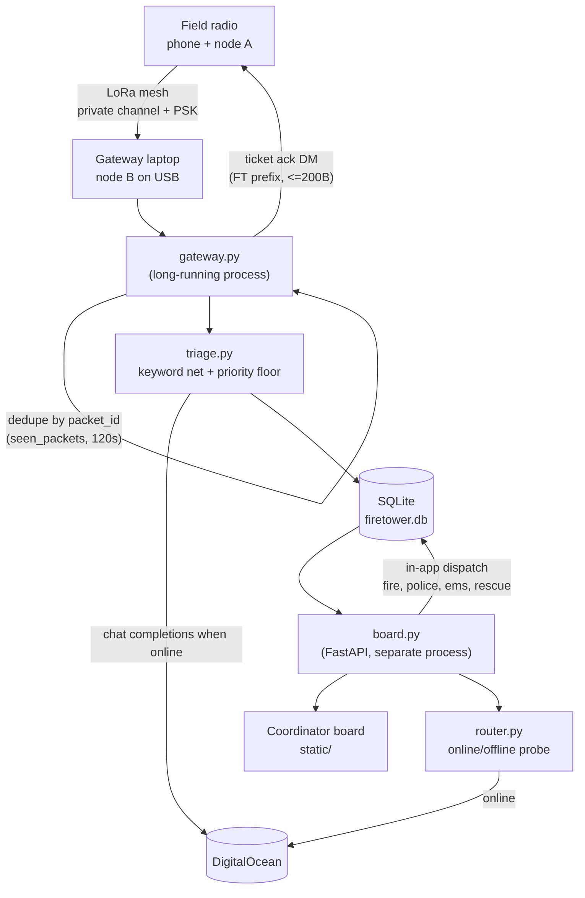

# Firetower

**Off-grid triage for when the towers go down.**

When a storm takes out cell towers and internet, people still need to report
emergencies, and someone still has to decide what to act on first. After
Hurricane Helene, one North Carolina county received about 11,000 requests
from people trying to find loved ones and had to sort them by hand.

Firetower lets people send short texts over low-cost Meshtastic LoRa radios
(no cell service or internet needed). Each message reaches a gateway computer
(a laptop for this prototype), where an open-weight model (OpenAI's
gpt-oss-20b, served by DigitalOcean) ranks it as EMERGENCY, PRIORITY, WELFARE
or ROUTINE and pulls out where it happened, what happened and how many people
are hurt. The sender gets a ticket number back over the radio, every reply is
confirmed delivered, and a coordinator board shows every report sorted by
urgency as it comes in.

When a report is missing a location or injury count, Firetower asks one short
follow-up question over the radio and adds the answer to the same ticket. If
the sender's radio has no GPS, it estimates where they are from the place they
named, the radio's last known position, or which radio relayed the message,
and marks the pin as an estimate. A keyword safety net catches urgent messages
the model ranks too low (words like trapped, bleeding or insulin), and
messages from priority nodes (shelters, households with a registered medical
need) are never ranked below Priority. A ticket closes only when the sender
says the situation is over, so "nobody hurt" never closes an active fire.

When the coordinator dispatches fire, police, EMS or rescue, Firetower radios
the reporter which teams are coming, and the map shows nearby fire stations,
hospitals and police stations with a simulated drive from the nearest one.
Firetower never dials 911 or contacts a department itself; a person makes that
call.

With the internet unplugged, Firetower keeps taking reports: the keyword net
ranks urgency, tickets are stored on the gateway, and the board keeps working.
The model's extraction and follow-up wording return when the link does.

In a real deployment, the laptop would be replaced by a rugged, low-power
computer such as an NVIDIA Jetson Orin, running on solar and battery power. It
would sit at a fixed site like a fire station or shelter, with a high-gain
antenna on a mast for better range. Because gpt-oss-20b is open-weight, a box
like that could also run the model on site, so full triage works with no
internet at all.

**Built with:** Meshtastic, Python, FastAPI, SQLite, DigitalOcean
(gpt-oss-20b), MapLibre, OpenStreetMap (Nominatim, Overpass, OSRM).

See [CLAUDE.md](CLAUDE.md) for the full architecture, schema, and dev setup.

## Architecture



Open emergency reports show the teams chosen from the report (fire, police,
EMS, rescue). Dispatch saves those teams on the ticket and radios the reporter
which teams the coordinator is sending. It does not dial 911, contact a
department, or read a script aloud. The map's driving animation from the
nearest station is a simulation.

## Quickstart

```
python -m venv .venv
source .venv/bin/activate   # .venv\Scripts\activate on Windows
pip install -r requirements.txt
cp .env.example .env         # DigitalOcean key, model, and base URL

python db.py                 # creates data/firetower.db for live mode
FIRETOWER_MOCK=1 uvicorn board:app --reload  # demo board with North Georgia GPS pins
python gateway.py            # gateway (needs a Meshtastic node on USB)
```

The board defaults to the real SQLite database (`FIRETOWER_MOCK=0`). Use
`FIRETOWER_MOCK=1` to preview the synthetic tickets and map positions.

Emergency and priority tickets with missing location or injury counts trigger
one follow-up question, phrased by DigitalOcean with a static fallback.
The ticket's nullable `clarification_question` and `clarification_response`
fields preserve the original question and sender's raw reply for the
coordinator board, alongside the extracted details. They are included in the
ticket API and mock fixtures. `db.init_db()` safely adds these columns to an
existing database, leaving historical tickets with null values.

`!ai <question>` answers from the sender's conversation and channel records,
including full-channel counts by urgency/status and the 40 most recent detailed
tickets with status, timestamps and clarification exchanges. Zero injuries is
kept distinct from an unknown count; replies are prompted to cite specific
ticket details and identify missing facts.

`!ai` replies use DigitalOcean's plain-text chat completion at temperature 0.2.
Reasoning text is stripped. If the cloud model is unconfigured, offline, or
the call fails, a fixed unavailable message is returned. Clarification
questions ask DigitalOcean for `{"question": string}` at temperature 0. Strict
JSON and question validation reject reasoning text, extra fields, invalid
characters, questions of 80 or more characters, and wording that fails to ask
for the missing details; failures use the static question template.

The gateway listens for Meshtastic `TEXT_MESSAGE_APP` and `POSITION_APP` packets
on `FIRETOWER_CHANNEL_INDEX`. Configure that channel with a private PSK on the
radios. The gateway exits at startup if that channel is missing, disabled, or
uses the unencrypted/public default key. Tickets retain a JSON snapshot of the
text packet and, when a position packet from the same node was received within
30 minutes, its coordinates and position packet. Tickets without a recent
position have null coordinates.

Receipt timestamps use the gateway laptop's UTC clock, so a radio clock that
lags the laptop does not make newly received GPS appear stale. The radio's
original `rxTime` remains in the JSON packet snapshots. Simulator GPS arriving
after a text report can attach to that ticket when `decoded.replyId` explicitly
references its text packet ID. The update requires the same sender and exact
packet ID and both ticket coordinates to be null; existing positions are
preserved, and older tickets are never broadly backfilled.

`fixtures/mock_meshtastic_packets.json` contains synthetic Meshtastic position
and text packets for local development; they are not captured radio
transmissions. Mock GPS positions are clustered in North Georgia and exist only
to demonstrate the map.

The board's topographic map plots only tickets with sender GPS coordinates.
It uses OpenFreeMap for streets and labels, with Mapterhorn hillshade and
contours. The map JavaScript and CSS are bundled under `static/vendor/`, but
the map tiles require internet unless a local tile source is configured.
`FIRETOWER_MOCK=1` includes synthetic GPS positions for every ticket to
demonstrate the map.

## What this is not

Not the first AI on Meshtastic. Not "disaster-proof." No medical advice, and
it does not replace or place 911 calls. "Works offline" applies to keyword
urgency, ticket storage, and the board's local data. Model extraction, `!ai`,
map lookups, station data, street routes, and map tiles need a connection.

## License

MIT — see [LICENSE](LICENSE).
