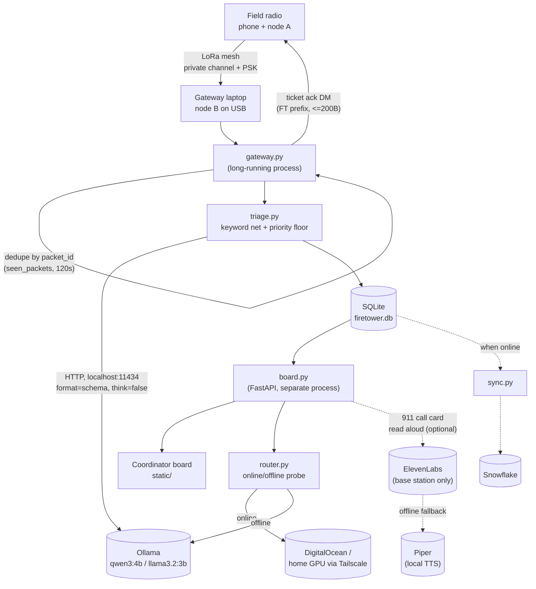

# Firetower

Off-grid triage for when the towers go down.

People in the field text short messages over Meshtastic LoRa radios (no cell
service or internet needed). A gateway laptop receives every message, and a
**local open-weight model** ranks its urgency (EMERGENCY / PRIORITY / WELFARE
/ ROUTINE) and pulls out where, what happened, and how many are hurt. The
sender gets a ticket number back over the radio. A coordinator board shows
everything sorted by urgency. Triage always runs on the laptop, so it keeps
working with the internet unplugged.

Other mesh AI projects answer the person who asked. Firetower sorts
everyone's messages for the person who has to act, keeps working offline, and
syncs when the link returns.

See [CLAUDE.md](CLAUDE.md) for the full architecture, schema, and dev setup.

## Architecture



ElevenLabs/Piper is optional and one-directional: the board calls it to read
the 911 script aloud at the base station. It is never wired into the mesh,
never triggers a call by itself, and is not required for the core triage loop
to work.

## Quickstart

```
python -m venv .venv
source .venv/bin/activate   # .venv\Scripts\activate on Windows
pip install -r requirements.txt
cp .env.example .env
ollama pull qwen3:4b

python db.py                 # creates data/firetower.db for live mode
FIRETOWER_MOCK=1 uvicorn board:app --reload  # demo board with North Georgia GPS pins
python gateway.py            # gateway (needs a Meshtastic node on USB)
```

The board defaults to the real SQLite database (`FIRETOWER_MOCK=0`). Use
`FIRETOWER_MOCK=1` to preview the synthetic tickets and map positions.

The gateway listens for Meshtastic `TEXT_MESSAGE_APP` and `POSITION_APP` packets
on `FIRETOWER_CHANNEL_INDEX`. Configure that channel with a private PSK on the
radios. Tickets retain a JSON snapshot of the text packet and, when a position
packet from the same node was received within 30 minutes, its coordinates and
position packet. Tickets without a recent position have null coordinates.
`fixtures/mock_meshtastic_packets.json` contains synthetic Meshtastic position
and text packets for local development; they are not captured radio
transmissions. Mock GPS positions are clustered in North Georgia and exist only
to demonstrate the map.

The board's topographic map plots only tickets with sender GPS coordinates.
It uses OpenFreeMap for streets and labels, with Mapterhorn hillshade and
contours. The map JavaScript and CSS are bundled under `static/vendor/`, but
the map tiles require internet unless a local tile source is configured.
`FIRETOWER_MOCK=1` includes synthetic GPS positions for every ticket to
demonstrate the map.

## What this is not

Not the first AI on Meshtastic. Not "disaster-proof." No medical advice, and
it does not replace or place 911 calls. "Works offline" applies to triage and
the local model only — Snowflake sync, cloud SITREPs, and map tiles need a
connection.

## License

MIT — see [LICENSE](LICENSE).
