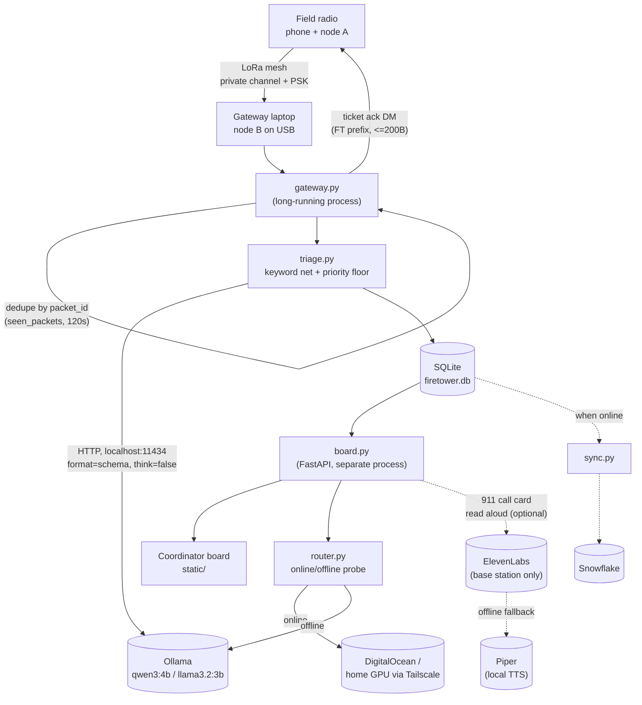

# Firetower

Off-grid triage for when the towers go down.

People in the field text short messages over Meshtastic LoRa radios (no cell
service or internet needed). A gateway laptop receives every message, and a
**local open-weight model** ranks its urgency (EMERGENCY / PRIORITY / WELFARE
/ ROUTINE) and pulls out where, what happened, and how many are hurt. The
sender gets a ticket number back over the radio. A coordinator board shows
everything sorted by urgency. Triage always runs on the laptop, so it keeps
working with the internet unplugged.

Other mesh AI projects answer the person who asked. Firetower sorts
everyone's messages for the person who has to act, keeps working offline, and
syncs when the link returns.

See [CLAUDE.md](CLAUDE.md) for the full architecture, schema, and dev setup.

## Architecture



ElevenLabs/Piper is optional and one-directional: the board calls it to read
the 911 script aloud at the base station. It is never wired into the mesh,
never triggers a call by itself, and is not required for the core triage loop
to work.

## Quickstart

```
python -m venv .venv
source .venv/bin/activate   # .venv\Scripts\activate on Windows
pip install -r requirements.txt
cp .env.example .env
ollama pull qwen3:4b

python db.py                 # creates data/firetower.db
uvicorn board:app --reload   # coordinator board at http://localhost:8000
python gateway.py            # gateway (needs a Meshtastic node on USB)
```

## What this is not

Not the first AI on Meshtastic. Not "disaster-proof." No medical advice, and
it does not replace or place 911 calls. "Works offline" applies to triage and
the local model only — Snowflake sync, cloud SITREPs, and map tiles need a
connection.

## License

MIT — see [LICENSE](LICENSE).
